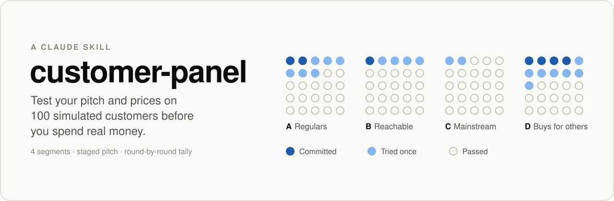
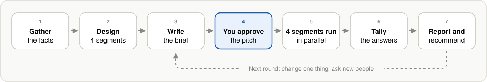

<picture>
  <source media="(prefers-color-scheme: dark)" srcset="assets/banner-dark.svg">
  
</picture>

<p align="center">
  <a href="LICENSE"></a>
  
  
</p>

**Find out who would buy before you build the page, set the price list or launch the offer.**

`customer-panel` is a Claude skill that builds 100 realistic customers, each with a budget, habits and a reason to say no. It takes every one of them through your pitch in the order a careful researcher would, then tallies:
- who buys;
- what one unit is worth to them;
- what they compare you to;
- what would change their mind.

> [!NOTE]
> AI customers are kinder than real ones. Treat the results as directional: good for finding objections, buyer segments and reference prices, but not a sales forecast and not customer research. Confirm prices with real money.

## Quick start

```bash
git clone https://github.com/talalshaikh/customer-panel ~/.claude/skills/customer-panel
```

Then ask Claude:

> Run a 100 customer panel on our new pricing: a £35 taster and a £225 six-week course.

Other things you can ask:

- *"Who would actually buy this? Test the pitch on our landing page with 100 customers."*
- *"We changed the launch offer. Re-run the panel and compare it with last round."*
- *"Quick 40-person check: would small agencies pay $49 a seat?"*

## How it works

<picture>
  <source media="(prefers-color-scheme: dark)" srcset="assets/workflow-dark.svg">
  
</picture>

### What every customer goes through

| Step | They see | What's recorded |
|:--:|---|---|
| 1 | Your pitch, **without prices** | Their first reaction, what they compare it to, and four price answers for one unit (Van Westendorp) |
| 2 | Your prices | What they would buy, if anything |
| 3 | Your follow-up offer | Whether it changes their mind |
| 4 | A question | The one addition that would raise what they'd pay, and by how much |
| 5 | Team offers (segment D only) | Interest, budget per head, and what they'd need |

Asking about price before showing prices matters. Once people see your numbers, their answers cluster around them.

### The four segments

| | Segment | Why it's there |
|:--:|---|---|
| **A** | Category regulars | They already pay for the alternatives |
| **B** | The first audience you can reach | Your real launch market |
| **C** | Mainstream control | Shows whether your targeting matters at all |
| **D** | Buys for others | HR and office managers, founders, gift buyers: often the best buyers |

## What you get

- **Who buys, and who pays**, by segment.
- **What one unit is worth before people see your price:** the acceptable range, the optimal price, and the share who'd call each of your prices too expensive.
- **What they compare you to**, and how that comparison sets their price ceiling.
- **Objections in their own words**, tagged and counted.
- **What would make it worth more**, ranked, with how much extra.
- **Demand from teams and companies**, with budgets and what they'd need.
- **A round-by-round comparison** when you change the pitch, the prices or the offer.

## Good to know

- **Cost.** A 100-person round runs four subagents that each write a long results file, so it's a sizeable token spend. Four segments of 10 is enough for a quick check.
- **Noise.** With 25 people per segment, a difference of two or three people between rounds means nothing. Trust big moves and patterns that repeat.
- **An honest pitch.** The skill checks the real product, pitches only what exists, and offers only what the business has approved, because the panel can only react to what you tell it.
- **Sharing results.** Label them "simulated AI customer panel, directional". Never call them a survey or customer research, and never use the quotes as testimonials.

## Requirements

- **Claude Code** runs the four segments in parallel with subagents.
- **Claude.ai** runs them one after another. To install there, download this repo as a zip and upload it as a skill in Claude's settings.
- **Node.js 16 or later**, for the tally script.

## What's inside

| File | What it is |
|---|---|
| [`SKILL.md`](SKILL.md) | The workflow Claude follows |
| [`references/brief-template.md`](references/brief-template.md) | The brief every segment follows: calibration rules, the staged pitch, the output format |
| [`references/segment-prompt.md`](references/segment-prompt.md) | The prompt for each segment's subagent, and the message for correcting a fact mid-run |
| [`references/panel-config.md`](references/panel-config.md) | The settings file for the tally script |
| [`references/reading-results.md`](references/reading-results.md) | How to read the numbers and write up a round |
| [`references/example-brief.md`](references/example-brief.md) | A filled-in example for a made-up pottery studio |
| [`scripts/tally.js`](scripts/tally.js) | Checks the data and tallies a round, optionally against an earlier one |

## Licence

[MIT](LICENSE)
